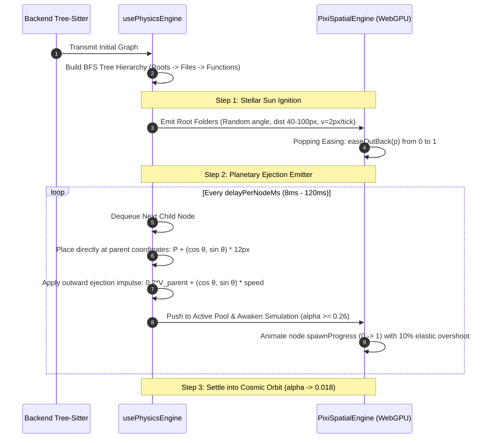

# NEURON SPATIAL IDE: AUTHENTIC GRAPH SYSTEM SPECIFICATION
## Comprehensive Architecture, Physics Laws, Mathematical Models & Interaction Blueprint

---

### Executive Architectural Blueprint

The **Neuron Spatial IDE** is a software intelligence platform that transforms raw codebases into an interactive, multi-dimensional topological universe. Unlike standard graph visualizations that render static diagrams, Neuron's core engine integrates deep **Tree-Sitter multi-language AST parsing**, **NetworkX & Scikit-Learn graph machine learning**, a **D3 numerical physics engine**, and a **WebGPU/Pixi.js v8 300 FPS viewport**.

```mermaid
flowchart TD
    subgraph Backend_Pipeline ["1. Backend Intelligence Pipeline (Python)"]
        TS["Tree-Sitter AST Parser (7 Multi-Language Grammars)"] -->|Extracts Folders, Files, Functions, Call Sites, HTTP/WS Routes| RAW[Raw Directed Graph]
        GIT["Git Commit Churn Analyzer"] --> RAW
        RAW --> ML["Graph ML Engine (NetworkX + Scikit-Learn)"]
        ML -->|1. Weighted Louvain Modularity (Q=0.742)| COMM[Community Clusters]
        ML -->|2. PageRank Authority + Betweenness Centrality| CENT[Node Centrality]
        ML -->|3. 10D Continuous Feature Tensor Synthesis| TENSOR[Feature Matrix in R^10]
        TENSOR -->|4. Scikit-Learn Isolation Forest (n_jobs=1)| ANOMALY[Code Smells & Risk Scores]
        COMM & CENT & ANOMALY --> WS_TX["WebSocket Router / JSON Sanitizer"]
    end

    subgraph Frontend_State ["2. Frontend State & Physics (React + D3)"]
        WS_RX["useWorkspace Hook"] -->|INIT / SYNC / GRAPH_DELTA| PHYS["usePhysicsEngine Hook"]
        PHYS -->|1. Defensive Deduplication & Zero-Copy RAM Pool| RAM["simDataRef (Master Memory Pool)"]
        PHYS -->|2. Incremental Celestial Birth (BFS Queue)| BIRTH["Sequential Stellar Emitter"]
        PHYS -->|3. D3 Force Integration (Resting alpha: 0.018)| D3["6-Force Euler Simulation"]
    end

    subgraph WebGPU_Renderer ["3. Graphics Engine (Pixi.js v8 + WebGPU)"]
        RAM & BIRTH & D3 --> ENGINE["PixiSpatialEngine"]
        ENGINE -->|Layer 1: BlurFilter(35) + C1 B-Splines| NEBULA["Louvain Community Nebulae"]
        ENGINE -->|Layer 2: Dynamic Zoom Scaled Conduits| EDGES["Hierarchy, Call & Bridge Lines"]
        ENGINE -->|Layer 3: Traveling White/Cyan Photons| PHOTONS["Cross-Stack Laser Photons"]
        ENGINE -->|Layer 4: Refactor Rings + CSP Shockwaves| OVERLAY["Interactive FX Overlays"]
        ENGINE -->|Layer 5: Procedural Merged Orbs (Tex r=256)| ORBS["Celestial Sphere Sprites"]
        ENGINE -->|Layer 6: Frustum-Culled Monospace Labels| LABELS["Dynamic LOD Monospace Text"]
        ENGINE -->|Real-time Coordinate Sync| MINIMAP["SpatialMinimap (Radar Projection)"]
        ENGINE -->|Double-Click Jump| MONACO["Monaco Editor (Code Jump at exact Line)"]
    end
```

---

## 1. What the Graph Represents & How It Looks

### 1.1 The 3 Cosmic Tiers of Nodes

In Neuron, code is conceptualized as a **planetary system**:

```
[Tier 0: Suns / Giants]       ──> Folders (Directories)
      │
      ├── [Tier 1: Planets]   ──> Files (.py, .jsx, .ts, .cpp, .c, .java)
            │
            └── [Tier 2: Moons]──> Functions, Classes, Methods (AST Symbols)
```

| Tier | Semantic Type | Visual Entity | Base Diameter | Mass | Repulsion Force | Default Color (Obsidian) |
|---|---|---|---|---|---|---|
| **Tier 0** | `folder` | **Sun / Giant** | $44\text{px}$ (Texture $r=256$) | $3.2$ | $-2600$ | Gold / Yellow (`#e4ef61` / `0xe4ef61`) |
| **Tier 1** | `file` | **Planet** | $26\text{px}$ (Texture $r=256$) | $2.0$ | $-900$ | Azure Blue (`#3b82f6` / `0x3b82f6`) |
| **Tier 2** | `function` | **Moon / Satellite**| $14\text{px}$ (Texture $r=256$) | $1.0$ | $-240$ | Electric Purple (`#8b5cf6` / `0x8b5cf6`) |

#### Risk & Smell Overrides
When the backend ML analyzer detects code anomalies, the node color is overridden:
* **High Risk / Anomaly**: Critical Red (`#ef4444` / `0xef4444`) with an expanding pulsing outer ring.
* **Medium Risk**: Warning Amber (`#f59e0b` / `0xf59e0b`).
* **Hovered / Selected**: Electric Blue Halo (`#60a5fa` / `0x60a5fa`) with $1.25\times$ scale expansion.

---

### 1.2 The 3 Types of Edge Conduits

Edges represent real structural, execution, and network relationships:

```
1. Hierarchy Edge:        [Folder] ────────────────────────── [File] ──────── [Function]
                           (Neutral gray solid line #6d6d6d, width 1.0, tension 0.95)

2. AST Call Edge:         [Function A] ═════════════════════════════════════> [Function B]
                           (Magenta conduit #9f00ad, width 1.6, glow #c084fc, tension 0.25)

3. Network Laser Bridge:  [Frontend fetch("/api/users")] ✦✦✦✦✦✦✦✦✦✦✦✦✦✦✦✦✦✦> [Backend router]
                           (High-voltage Cyan laser #00f0ff, width 2.5, traveling photons)
```

#### Edge Specifications

| Conduit Type | Visual Style | Base Width | Tension | Resting Spring Length | Visual Features |
|---|---|---|---|---|---|
| **`hierarchy`** | Neutral Solid Slate (`#6d6d6d`) | $1.0\text{px}$ | $0.95$ | Moon: $45\text{px}$ / Planet: $95\text{px}$ | Fades out when children merge into parent. |
| **`call`** | Electric Magenta (`#9f00ad`) | $1.6\text{px}$ | $0.25$ | $180\text{px}$ | Glows `#c084fc` ($w=3.8\text{px}$) on hover ray-trace. |
| **`network_bridge`** | Electric Laser Cyan (`#00f0ff`) | $2.5\text{px}$ | $0.35$ | $216\text{px}$ | Dual traveling white/cyan photons stream across it. |

---

### 1.3 Louvain Community Nebulae (Organic Code Galaxies)

Nodes belong to distinct **Louvain Modularity Communities** (computed by NetworkX with $Q \approx 0.742$). In the viewport, each community is visualized as an organic, floating **nebula cloud**:

1. **Algorithm**:
   * For each community, gathers member coordinates $(rx, ry)$ and generates 12 radial envelope points:
     $$\vec{P}_{k} = \left(rx + R_{halo} \cos\frac{2\pi k}{12}, \ ry + R_{halo} \sin\frac{2\pi k}{12}\right)$$
     Where $R_{halo} = R_{world} \cdot 1.35 + \text{Pad}_{base}(1 - 0.7m)$.
   * Computes the convex hull using **Andrew's Monotone Chain 2D Convex Hull Algorithm** in $\mathcal{O}(n \log n)$.
   * Smooths the hull into a continuous $C^1$ **B-Spline curve** (quadratic Bézier curve through segment midpoints).
   * Passes the layer through a GPU **`PIXI.BlurFilter(blur: 35)`** with $0.08$ fill opacity and $0.22$ stroke opacity.
2. **Community Palette Matrix**:
   * Community 0 (Core Backend): Royal Blue (`#3b82f6`)
   * Community 1 (Graph ML Engine): Electric Purple (`#a855f7`)
   * Community 2 (Microservices & AI): Emerald Green (`#22c55e`)
   * Community 3 (Spatial Viewport): Hot Pink (`#ec4899`)
   * Community 4 (UI Layout): Amber Gold (`#eab308`)
   * Community 5 (State & Hooks): Solar Orange (`#f97316`)

---

## 2. Backend Code Analysis Pipeline (`parser.py` & `analyzer.py`)

### 2.1 Multi-Language AST Parser
1. **Tree-Sitter Grammars**: Persistent parsers for Python, JS, TS, TSX, C, C++, and Java.
2. **Incremental AST Cache**: Keyed on `(rel_path, abs_target) -> (mtime, file_size, cached_ast)`.
3. **Symbol Extraction**:
   * Functions, methods, and classes are mapped with line numbers and cyclomatic complexity.
   * `DECISION_TRIGGERS`: `if_statement`, `for_statement`, `while_statement`, `match_statement`, `except_clause`, `switch_case`, `list_comprehension`, etc.
4. **Cross-Stack Route Linker**:
   * Backend routes (`@router.get('/api/users')`, `app.post(...)`, WebSocket events) are registered.
   * Frontend network calls (`fetch('/api/users')`, `axios.get(...)`, `socket.emit(...)`) are resolved.
   * Matching normalized URIs instantiate `network_bridge` laser conduits.

---

### 2.2 Graph Machine Learning (`analyzer.py`)
1. **Weighted Dual-Graph**:
   * Undirected Graph $G$ for Louvain community clustering.
   * Directed Graph $\text{Di}G$ for PageRank flow and authority.
   * Edge weights: `network_bridge` $= 60.0$, `call` $= 40.0$, `import` $= 20.0$, `hierarchy` $= 1.0$.
2. **Centrality Metrics**:
   * **PageRank** ($\alpha = 0.85$, tol $= 10^{-5}$): Measures architectural gravity.
   * **Betweenness Centrality**: Identifies system bottlenecks connecting separate sub-modules.
3. **10-Dimensional Feature Tensor & Scikit-Learn Isolation Forest**:
   Synthesizes a continuous vector for each node:
   $$\vec{x} = [\text{LOC}, \text{Complexity}, \text{Density}, \text{Nesting}, \text{Params}, \text{GitChurn}, \text{PageRank}, \text{Betweenness}, \text{FanRatio}, \text{ShannonEntropy}] \in \mathbb{R}^{10}$$
   * **Shannon Entropy**: $H(X) = -\sum P(x) \log_2 P(x)$ over raw character byte frequencies.
   * Trains an **Isolation Forest** ($n_{estimators} = 80$, contamination $\in [0.02, 0.12]$, $n_{jobs} = 1$).
4. **Architectural Smell Diagnosis**:
   * **God Object**: $\text{LOC} > 120 \land \text{PageRank} > 0.70$
   * **Spaghetti Logic**: $\text{Density} > 0.35 \lor (\text{Entropy} > 4.85 \land \text{LOC} < 25)$
   * **Fragile Hotspot**: $\text{GitChurn} \ge 3 \land \text{Complexity} \ge 4$
   * **System Bottleneck**: $\text{Betweenness} > 0.65$
   * **Dead Code Candidate**: In-degree $= 0 \land$ Out-degree $= 0 \land \text{LOC} > 10$

---

## 3. Physics Simulation Laws (`usePhysicsEngine.js`)

All node movement is computed via a continuous **D3 Numerical Force Simulation** running semi-implicit Euler integration with zero-copy shared memory access.

### 3.1 Mathematical Laws of the Universe

```javascript
const PHYSICS_CONSTANTS = {
  GRAVITY_PULL: 0.025,
  ALPHA_DECAY: 0.012,
  VELOCITY_DECAY: 0.54,
  RESTING_ALPHA: 0.018,    // Cosmic perpetual float
  DRAGGING_ALPHA: 0.25,   // High responsiveness during user drag
  REPULSION: {
    folder: -2600,         // Suns push firmly outwards
    file: -900,            // Planets space out cleanly
    function: -240         // Moons orbit smoothly without exploding
  },
  SPRING_DISTANCE: {
    moonOrbit: 45,         // Distance between function and file
    planetOrbit: 95,       // Distance between file and folder
    neuralCall: 180,       // Cross-file call conduits
    laserBridge: 216       // Cross-stack laser bridges
  },
  SPRING_STRENGTH: {
    structural: 0.95,      // Stiff structural containment
    bridge: 0.35,          // Medium tension laser link
    neural: 0.25           // Flexible call pathway
  },
  COLLISION_RADIUS: {
    folder: 48,
    file: 26,
    function: 15
  }
};
```

1. **Hooke's Spring Law with Dynamic Mass Spacing**:
   $$\vec{\Delta} = (T_x + T_{vx}) - (S_x + S_{vx}), \quad l = \|\vec{\Delta}\|_2$$
   $$d_{target} = d_{base} + (R_{src}^{extra} + R_{tgt}^{extra}) \cdot 1.2 \cdot \text{RepulseStrength}$$
   $$\delta = \frac{l - d_{target}}{l} \cdot \alpha \cdot k_s$$
   $$\vec{T}_v \leftarrow \vec{T}_v - 0.5 \vec{\Delta} \delta, \quad \vec{S}_v \leftarrow \vec{S}_v + 0.5 \vec{\Delta} \delta$$
2. **Mass-Boosted $N$-Body Electrostatic Repulsion**:
   $$\text{Charge} = \text{Charge}_{base} \cdot \left(1 + \min(4.0, \text{Mass}^{0.52} \cdot 0.45 \cdot \text{Repulse})\right) \cdot (1 - 0.9m)$$
3. **Collision Sphere Resolution**:
   $$\text{Radius}_{collide} = (R_{base} + 10 + R_{extra} \cdot 1.15 \cdot \text{Repulse}) \cdot (1 - 0.85m)$$

---

## 4. How the Graph Animates on First Display: Incremental Celestial Birth

On startup, Neuron does **not** snap nodes onto the screen. It executes a **staggered celestial accretion sequence**:



### 4.1 Ejection Velocity Formula
Child node $C$ is ejected directly from parent $P$:
$$C_x = P_x + 12 \cos\theta, \quad C_y = P_y + 12 \sin\theta, \quad \theta \sim \mathcal{U}(0, 2\pi)$$
$$\vec{C}_v = 0.2 \cdot \vec{P}_v + (\cos\theta, \sin\theta) \cdot v_{speed}$$
Where $v_{speed} = 6.5\text{ px/tick}$ for Files (Planets) and $3.5\text{ px/tick}$ for Functions (Moons).

### 4.2 Elastic Bounce Popping (`easeOutBack`)
As `node.spawnProgress` interpolates from $0 \to 1$:
$$f(x) = 1 + 2.70158(x - 1)^3 + 1.70158(x - 1)^2$$
Nodes burst outward, overshoot by $\approx 10\%$, and bounce elastically as the D3 springs pull them into orbital equilibrium.

---

## 5. Multi-Stage Hierarchical Zoom Merging & Division Engine

Neuron's signature mechanical feature is **multi-stage spatial zoom coalescence**. As the camera zooms in or out, nodes **procedurally merge into their parent orbs or divide back out into planetary orbits**.

```mermaid
stateDiagram-v2
    direction LR
    [*] --> DeepZoom: Zoom > 0.35 (LOD 0)
    DeepZoom --> FunctionsMerged: Zoom < 0.35 (LOD 1)
    FunctionsMerged --> FilesMerged: Zoom < 0.22 (LOD 2)
    FilesMerged --> SubfoldersMerged: Zoom < 0.12 (LOD 3)
    SubfoldersMerged --> RootCoalescence: Zoom < 0.05 (LOD 4)

    state DeepZoom {
        Moons_Orbit_Planets
        Planets_Orbit_Suns
    }
    state FunctionsMerged {
        Moons_Swallowed_Into_Planets
        Planets_Swell_In_Size
    }
    state FilesMerged {
        Planets_Swallowed_Into_Suns
        Suns_Swell_In_Size
    }
    state SubfoldersMerged {
        Subfolders_Absorbed_By_TopFolders
    }
    state RootCoalescence {
        Entire_Repo_Merged_Into_Single_Orb
    }
```



### 5.1 The 4 Camera Zoom Breakpoints

| Level | Default Threshold | Merging Behavior | Swelling & Physics Reaction |
|---|---|---|---|
| **LOD 1** | $\zeta < 0.35$ | Functions $\to$ File | Function moons spiral into parent File planet; File swells proportionally. |
| **LOD 2** | $\zeta < 0.22$ | Files $\to$ Folder | File planets spiral into parent Folder sun; Folder swells into massive super-sun. |
| **LOD 3** | $\zeta < 0.12$ | Subfolders $\to$ TopFolder | Deep directories collapse into primary domain hubs. |
| **LOD 4** | $\zeta < 0.05$ | TopFolders $\to$ Root Hub | The entire repository collapses into a single dense pulsating cosmic orb. |

A dynamic hysteresis band ($\pm 3.5\%$ of threshold) prevents jitter or rapid toggling when the user stops zooming at a boundary.

### 5.2 Three-Pass Procedural Computation (Every Frame)

#### Pass 1: Threshold & Progress Calculation
```javascript
const animRate = Math.max(0.02, Math.min(0.25, transitionSpeed * animSpeed * 0.16));
const ease = Math.sin(prevM * Math.PI) * 0.8 + 0.2;
const step = Math.sign(targetMerge - prevM) * Math.max(0.018 * animSpeed, animRate * ease);
obj.mergeProgress = Math.min(1.0, Math.max(0.0, prevM + step));
```

#### Pass 2: Mass Absorption & World Radius Swelling
As children merge ($m > 0$), their mass transfers to the parent:
$$\text{TransferredMass} = m^2 \cdot (\text{IntrinsicMass} + \text{AbsorbedMass})$$
Parent orbs expand in world space:
$$\text{MassSwell} = 1.0 + \min\left(3.6, (\text{AbsorbedMass})^{0.52} \cdot 0.42\right)$$
$$\text{ChildScale} = \begin{cases} 1.0, & m \le 0.40 \\ 1.0 - (3u^2 - 2u^3) \cdot 0.88, \quad u = \frac{m - 0.40}{0.60}, & m > 0.40 \end{cases}$$
$$\text{ChildAlpha} = \begin{cases} 1.0, & m \le 0.52 \\ 1.0 - \left(\frac{m - 0.52}{0.45}\right)^2, & m > 0.52 \end{cases}$$

#### Pass 3: FNV-1a Hash Spiral Trajectory Interpolation
The rendered screen coordinates $(rx, ry)$ interpolate cleanly into the parent orb with an organic vortex swirl:
1. **FNV-1a 32-bit Hash**:
   $$h \leftarrow 2166136261, \quad h \leftarrow (h \oplus \text{code}) \times 16777619, \quad \text{hash} = \frac{(h \text{ >>> } 0) \pmod{10000}}{10000}$$
   $$\text{SwirlFactor} = (\text{hash} \ge 0.5 \ ? \ 1 \ : \ -1) \cdot (0.08 + (\text{hash} \pmod{0.06}))$$
2. **Vortex Position**:
   $$\Delta x = x - px, \quad \Delta y = y - py$$
   $$\text{Pull} = m^2(3 - 2m), \quad \text{Swirl} = m(1 - m) \cdot \text{SwirlFactor}$$
   $$rx = px + \Delta x(1 - \text{Pull}) - \Delta y \cdot \text{Swirl}$$
   $$ry = py + \Delta y(1 - \text{Pull}) + \Delta x \cdot \text{Swirl}$$

---

## 6. How the Graph Behaves Under User Interaction

### 6.1 Hover Ray-Tracing (`activeRay`)
Hovering any node runs an instantaneous bidirectional Breadth-First Search traversal:
* Connected callers, callees, parent folders, and children light up in **Electric Blue/Magenta Glow** ($w=3.8\text{px}$).
* All non-connected nodes and conduits dim to $0.04$ opacity.

### 6.2 Double-Click to Code Navigation
Double-clicking any node emits:
```javascript
onNodeDoubleClick(node.data?.filePath || node.id, node.data?.line || 1);
```
Instantly switches the IDE to the **Monaco Code Editor**, opens the exact file, and jumps to the exact line number!

### 6.3 Drag-and-Drop Refactoring & Merge Zones
* **Function Relocation**: Dragging a function within $85\text{px}$ of a foreign file triggers a **Pulsing Cyan Capture Ring** (`#38bdf8`). Dropping triggers an automated AST AST extraction, import rewrite, and module relocation.
* **File Merging**: Dragging a file within $110\text{px}$ of another file triggers an **Amber Merge Ring** (`#f59e0b`). Dropping fuses the two files.

### 6.4 CSP Guard Rejection Shockwave & Snap-Back
If an illegal operation is attempted (e.g. violating Content Security Policy or cyclic rules):
1. **Expanding Red Shockwave**: Ring expands at $5\text{px/tick}$ with alpha decaying by $0.024/\text{tick}$ in `#ef4444`.
2. **Cubic Snap-Back Trajectory**:
   $$\text{Pos}(t) = \text{Pos}_{start} + (\text{Pos}_{origin} - \text{Pos}_{start}) \cdot (1 - (1 - t)^3)$$
   The dragged orb snaps back to its origin within $300\text{ms}$.

### 6.5 Cinematic 3D Camera Warp Flight
Selecting a file or symbol in Omni-Search triggers an automated camera trajectory via **Quintic Ease-In-Out**:
$$f(t) = \begin{cases} 16 t^5, & t < 0.5 \\ 1 - \frac{(-2t + 2)^5}{2}, & t \ge 0.5 \end{cases}$$
Smoothly glides the camera from macro overview down to deep focus ($\zeta = 1.55$) and highlights the target node.

### 6.6 Real-Time Live Graph Hot-Patching (`GRAPH_DELTA`)
When files are edited, saved, or generated by AI, the backend sends a live `GRAPH_DELTA` WebSocket message containing:
`nodes_upsert`, `nodes_remove`, `edges_upsert`, `edges_remove`.
The frontend merges the delta into `simDataRef` **without restarting the simulation or reloading the canvas**, preserving all current orb positions and camera zoom seamlessly!

---

## 7. Complete Configurable Settings Registry

Users can customize the spatial engine in the Settings modal:

| Setting Key | Default | Type | Description |
|---|---|---|---|
| `spatialNodeScale` | `1.0` | Float $[0.05, 5.0]$ | Global diameter multiplier for all orbs. |
| `spatialLineScale` | `1.0` | Float $[0.05, 5.0]$ | Global stroke thickness multiplier for conduits. |
| `spatialTextScale` | `1.0` | Float $[0.05, 5.0]$ | Global font size multiplier for monospace labels. |
| `spatialAnimationSpeed` | `1.0` | Float $[0.05, 10.0]$ | Time delta multiplier for all physics and shaders. |
| `spatialSelectedLineWidth`| `3.8` | Float $[0.1, 10.0]$ | Thickness of active ray-trace highlighted edges. |
| `spatialBridgeLineWidth` | `2.5` | Float $[0.1, 8.0]$ | Thickness of cross-stack laser conduits. |
| `spatialPurpleLineWidth` | `1.6` | Float $[0.1, 6.0]$ | Thickness of dynamic AST call edges. |
| `spatialFolderLabelZoom` | `0.10` | Float $[0.005, 1.0]$ | Camera zoom threshold to show folder labels. |
| `spatialFileLabelZoom` | `0.25` | Float $[0.01, 2.0]$ | Camera zoom threshold to show file labels. |
| `spatialFuncLabelZoom` | `0.55` | Float $[0.01, 3.0]$ | Camera zoom threshold to show function labels. |
| `spatialMergeRepulsion` | `1.5` | Float $[0.05, 5.0]$ | Extra repulsion factor applied to swollen orbs. |
| `spatialTransitionSpeed` | `0.28` | Float $[0.01, 2.0]$ | Rate of autonomous procedural zoom coalescence. |
| `spatialLod1Zoom` | `0.35` | Float $[0.01, 1.0]$ | Zoom breakpoint where functions merge into files. |
| `spatialLod2Zoom` | `0.22` | Float $[0.005, 0.8]$ | Zoom breakpoint where files merge into folders. |
| `spatialLod3Zoom` | `0.12` | Float $[0.005, 0.5]$ | Zoom breakpoint where subfolders merge into top-level. |
| `spatialLod4Zoom` | `0.05` | Float $[0.001, 0.3]$ | Zoom breakpoint where top folders coalesce into root. |
| `spatialMinimap` | `true` | Boolean | Toggles the 136x84px real-time radar minimap. |
| `spatialParticles` | `true` | Boolean | Toggles traveling photons on cross-stack bridges. |
