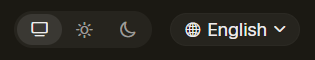
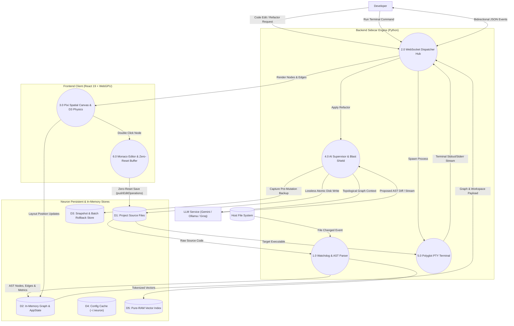
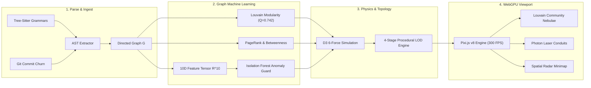
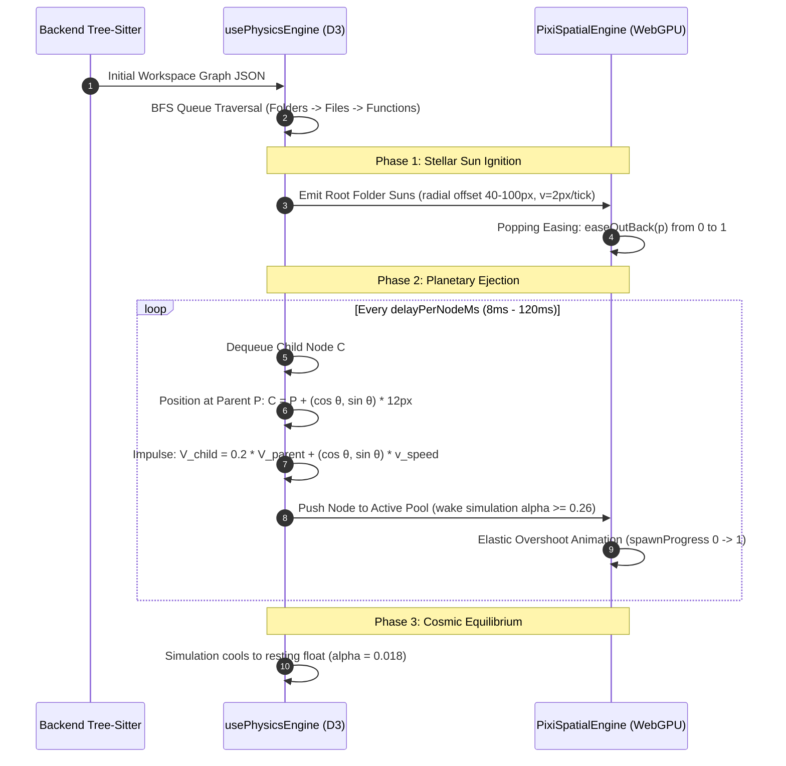
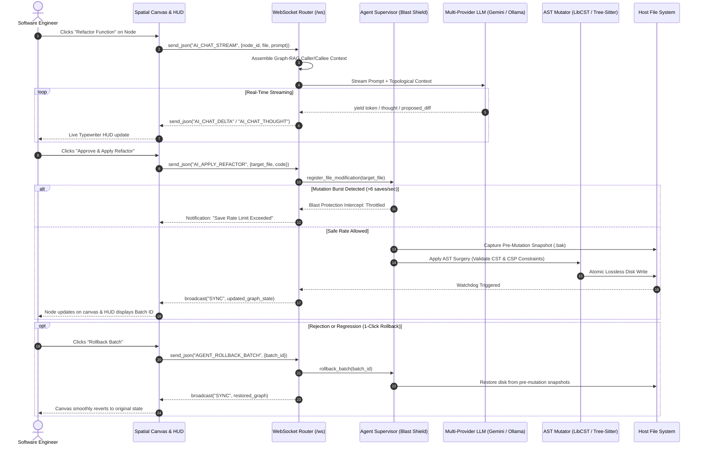

<div align="center">

  

  # 🧠 Neuron Spatial IDE
  ### **The Spatial Code Intelligence & Graph Machine Learning Development Environment**

  *Transforming linear source code into a living, multi-dimensional topological universe.*

  <p align="center">
    <a href="https://neuron-website-ruby.vercel.app/"></a>
    <a href="https://github.com/UnityNimit/Neuron/releases"></a>
    <a href="docs/software_engineering/system_design_specification.md"></a>
    <a href="LICENSE"></a>
  </p>

  <p align="center">
    
    
    
    
    
    
  </p>

</div>

---

<p align="center">
  
</p>

<p align="center">
  
</p>

---

## 📑 Table of Contents

- [Executive Summary](#-executive-summary)
- [Language Bricks & Technology Matrix](#-language-bricks--technology-matrix)
- [Cosmic Design System & Visual Grammar](#-cosmic-design-system--visual-grammar)
- [System Architecture & Data Flow](#-system-architecture--data-flow)
- [Procedural Hierarchical Spatial Engine (LOD 0 – 4)](#-procedural-hierarchical-spatial-engine-lod-0--4)
- [Autonomous AI Engine & Blast Shield Supervisor](#-autonomous-ai-engine--blast-shield-supervisor)
- [Interactive IDE Features & Developer Experience](#-interactive-ide-features--developer-experience)
- [Repository Folder Structure](#-repository-folder-structure)
- [Configurable Live Settings Registry](#-configurable-live-settings-registry)
- [IEEE 829 Software Engineering Quality Assurance](#-ieee-829-software-engineering-quality-assurance)
- [Installation, Build & Development Guide](#-installation-build--development-guide)
- [Release Notes & Subsystem Architecture](#-release-notes--subsystem-architecture)
- [Security, Privacy & Verification](#-security-privacy--verification)
- [License & Acknowledgments](#-license--acknowledgments)

---

## 🌟 Executive Summary

Traditional code editors treat software systems as static files organized in linear disk directories. When codebases scale to thousands of functions, developers suffer from cognitive disorientation, losing sight of cross-module dependencies, circular imports, and architectural blast radius.

**Neuron** revolutionizes software development by mapping abstract syntax trees (ASTs) directly onto an interactive, multi-dimensional **2D topological spatial universe**:

1. **Topological Code Comprehension:** Functions, modules, classes, and decorated endpoints exist as physical celestial bodies connected by real-time call conduits and Louvain community nebulae.
2. **100% Localhost Isolation & Zero Telemetry:** Tree-sitter parsers, graph machine learning models, physics solvers, and memory vectors run strictly on your local hardware (`127.0.0.1`).
3. **Bidirectional AST Synchronization:** Edits in physical files immediately re-triangulate the spatial graph, while dragging and dropping nodes on the canvas mutates concrete syntax trees on disk losslessly.
4. **Autonomous AI Blast Protection:** The integrated agent supervisor captures pre-mutation disk snapshots, throttles mutation bursts ($>6\text{ saves/s}$), and enables **1-Click Rollback/Reapply** for all AI refactorings.
5. **Hardware-Accelerated WebGPU Rendering:** Powered by **Pixi.js v8** and a velocity-damped **D3 Numerical Force Simulation**, delivering an ultra-smooth 300 FPS viewport with dynamic Level of Detail (LOD).

---

## 🧱 Language Bricks & Technology Matrix

Neuron is built as a high-performance polyglot architecture combining compiled systems code, machine learning pipelines, and hardware-accelerated rendering.

### Language Breakdown

<p align="left">
  
  
  
  
  
  
  
  
  
  
</p>

| Language / Stack | Composition | Subsystem Role | Key Libraries & Grammars |
| :--- | :---: | :--- | :--- |
| **Python 3.11+** | `42%` | **Backend Core & ML Intelligence** | FastAPI, Uvicorn, Tree-Sitter, LibCST, NetworkX, Scikit-Learn, NumPy, SciPy, Watchdog, PyInstaller |
| **JavaScript (ESNext / JSX)** | `38%` | **Spatial Client & Interactive IDE** | React 19, Monaco Editor, xyflow, D3 Force, Pixi.js v8, Pixi-Viewport, Lucide, Pyodide |
| **Rust** | `10%` | **Native Desktop Host & Shell** | Tauri v2.2, Cargo, Windows NSIS Hook, Native Shell Process Spawner |
| **TypeScript** | `6%` | **Type Declarations & Schemas** | AST Grammars, WebSocket Contract Schemas, WebGPU Shader Types |
| **Tailwind / CSS3** | `4%` | **Fluid Layouts & Theme Accents** | Tailwind CSS v4, Detached Floating Card Tabs, Monaco CSS Dynamic Bindings |

### Multi-Language AST Grammar Support

Neuron features continuous, in-memory Tree-Sitter grammars capable of extracting functions, classes, decorators, routes, and call-sites across:

- 🐍 **Python** (`tree-sitter-python` + `LibCST`)
- 🌐 **JavaScript & JSX** (`tree-sitter-javascript`)
- 🔷 **TypeScript & TSX** (`tree-sitter-typescript`)
- ⚙️ **C & C++** (`tree-sitter-c`, `tree-sitter-cpp`)
- ☕ **Java** (`tree-sitter-java`)

---

## 🎨 Cosmic Design System & Visual Grammar

In Neuron, a codebase is modeled as a physical **stellar planetary system**. Nodes have mass, diameter, and gravitational attraction governed by their position in the software hierarchy.

```
[Tier 0: Suns / Stellar Giants] ──────── Folders & Packages
          │
          ├── [Tier 1: Planets] ──────── Source Files (.py, .jsx, .ts, .c)
                │
                └── [Tier 2: Moons] ──── Functions, Classes & AST Symbols
```

### 1. Node Hierarchy & Orbital Mechanics

| Tier | Semantic Entity | Cosmic Visual | Base Diameter | Mass | Repulsion Force | Default Color (Obsidian) |
| :---: | :--- | :--- | :---: | :---: | :---: | :--- |
| **Tier 0** | Directory / Folder | **Stellar Sun** | $44\text{px}$ | $3.2$ | $-2600$ | Gold / Yellow (`#e4ef61`) |
| **Tier 1** | Physical Source File | **Planetary Orb** | $26\text{px}$ | $2.0$ | $-900$ | Azure Blue (`#3b82f6`) |
| **Tier 2** | Function / Method / Class | **Orbital Moon** | $14\text{px}$ | $1.0$ | $-240$ | Electric Purple (`#8b5cf6`) |

#### Risk Overrides & ML Anomaly Indicators
When backend machine learning detects architectural anomalies, orb aesthetics dynamically change:
- 🔴 **Critical Risk / God Object:** Vivid Red (`#ef4444`) with an expanding harmonic perimeter pulse.
- 🟠 **Moderate Complexity / Smell:** Warning Amber (`#f59e0b`).
- 🔵 **Hovered / Selected Symbol:** Electric Blue Halo (`#60a5fa`) with $1.25\times$ scale expansion.

---

### 2. High-Voltage Edge Conduits

```
1. Hierarchy Conduits:    [Folder Sun] ────────────────────────── [File Planet] ──────── [Function Moon]
                           (Solid Slate #6d6d6d, width 1.0px, tension 0.95)

2. AST Call Pathways:     [Function A] ═════════════════════════════════════════════════> [Function B]
                           (Electric Magenta #9f00ad, width 1.6px, glow #c084fc on hover)

3. Cross-Stack Bridges:   [Frontend: fetch('/api')] ✦✦✦✦✦✦✦✦✦✦✦✦✦✦✦✦✦✦✦✦✦✦✦✦✦✦✦✦✦✦✦✦✦✦> [Backend: @router.get]
                           (Laser Cyan #00f0ff, width 2.5px, traveling photon particles)
```

| Conduit Type | Semantic Function | Stroke Color | Base Width | Tension | Resting Distance | Special VFX |
| :--- | :--- | :--- | :---: | :---: | :---: | :--- |
| **`hierarchy`** | Containment tree | Slate (`#6d6d6d`) | $1.0\text{px}$ | $0.95$ | $45\text{px} - 95\text{px}$ | Smoothly dissolves when children merge into parent. |
| **`call`** | Invocation call-site | Magenta (`#9f00ad`) | $1.6\text{px}$ | $0.25$ | $180\text{px}$ | Active ray-trace highlight expands to $3.8\text{px}$ with cyan glow. |
| **`network_bridge`** | Full-stack HTTP/WS bridge | Laser Cyan (`#00f0ff`) | $2.5\text{px}$ | $0.35$ | $216\text{px}$ | Streams dual white/cyan photons traversing across the conduit. |

---

### 3. Louvain Community Nebulae

Nodes belong to distinct architectural domains computed via **Weighted Louvain Modularity** ($Q \approx 0.742$). In the viewport, each community is enveloped in an organic, glowing nebula:
1. **Halo Sampling:** Member coordinates generate 12 perimeter points weighted by node mass:
   $$\vec{P}_{k} = \left(rx + R_{halo} \cos\frac{2\pi k}{12}, \ ry + R_{halo} \sin\frac{2\pi k}{12}\right)$$
2. **Convex Hull Generation:** Andrew's Monotone Chain 2D Convex Hull computed in $\mathcal{O}(n \log n)$.
3. **Continuous B-Splines:** Hull segments smooth through segment midpoints via quadratic Bézier curves (`quadraticCurveTo`).
4. **WebGPU Blur Shader:** Rendered on a dedicated GPU render layer with `PIXI.BlurFilter(blur: 35)` and dynamic alpha blending.

---

### 4. Vector SVG Logo & Genesis Liquid Fusion Animation

Neuron features an authentic, scalable vector brand geometry (`logon.svg` / `NeuronLogo.jsx` / `GenesisAnimatedLogo.jsx`):
- **Theme-Reactive Vector Architecture:** Built with pure SVG curves using CSS `currentColor` / `var(--theme-accent)`.
- **Zero-GC Frame Ticker:** The Genesis Splash screen animates 7 orbital lobes and 5 cutter arcs that fuse together in a continuous liquid vortex using precomputed trigonometric lookup tables.

---

## 🏗️ System Architecture & Data Flow

Neuron operates as a synchronized desktop sidecar system. The native Tauri desktop client coordinates with a Python FastAPI backend daemon over high-throughput WebSockets.

### Level 1 Data Flow Diagram (DFD)



---

### Subsystem Pipeline Execution



---

## 🔍 Procedural Hierarchical Spatial Engine (LOD 0 – 4)

Neuron replaces static node clusters with a continuous, **procedural 4-stage aggregation and division engine**. As the developer pans and zooms across orders of magnitude, code elements seamlessly coalesce:

$$\text{Function (Moons)} \xrightarrow{\zeta < 0.35} \text{File (Planets)} \xrightarrow{\zeta < 0.22} \text{Subfolder (Suns)} \xrightarrow{\zeta < 0.12} \text{Root Folder} \xrightarrow{\zeta < 0.05} \text{Core Hub}$$

```mermaid
stateDiagram-v2
    direction LR
    [*] --> LOD0_DeepFocus : Zoom > 0.35
    LOD0_DeepFocus --> LOD1_FunctionsMerged : Zoom <= 0.35
    LOD1_FunctionsMerged --> LOD2_FilesMerged : Zoom <= 0.22
    LOD2_FilesMerged --> LOD3_SubfoldersMerged : Zoom <= 0.12
    LOD3_SubfoldersMerged --> LOD4_CoreHub : Zoom <= 0.05

    state LOD0_DeepFocus {
        Functions_Orbit_Files
        Files_Orbit_Folders
        Labels_Fully_Crisp
    }
    state LOD1_FunctionsMerged {
        Functions_Absorbed_By_Files
        Files_Swell_Proportionally
        Function_Labels_Fade
    }
    state LOD2_FilesMerged {
        Files_Absorbed_By_Folders
        Folders_Swell_Into_Giants
        Conduits_Deduplicate
    }
    state LOD3_SubfoldersMerged {
        Subfolders_Merge_To_Domain_Hubs
        Macro_Architecture_Visible
    }
    state LOD4_CoreHub {
        Entire_Repository_Single_Dense_Orb
        Perimeter_Activity_Pulses
    }
```



### Zoom Breakpoints & Physics Responses

| Level | Threshold ($\zeta$) | Aggregation Action | Physics & Mass Swell Reaction |
| :---: | :---: | :--- | :--- |
| **LOD 0** | $\zeta > 0.35$ | **Deep Focus** | All functions, classes, and call conduits are visible with full typography. |
| **LOD 1** | $\zeta \le 0.35$ | **Function $\to$ File** | Moons spiral into parent File orbs; File radius swells: $\text{MassSwell} = 1 + \min(3.6, M_{abs}^{0.52} \cdot 0.42)$. |
| **LOD 2** | $\zeta \le 0.22$ | **File $\to$ Subfolder** | File planets spiral into parent Subfolder suns; connecting edges bundle into single conduits. |
| **LOD 3** | $\zeta \le 0.12$ | **Subfolder $\to$ Root** | Deep folder trees coalesce into primary domain hubs; file labels smoothly fade out. |
| **LOD 4** | $\zeta \le 0.05$ | **Root $\to$ Core Hub** | The entire repository collapses into a single dense pulsating cosmic core. |

*Note: A $\pm 3.5\%$ dynamic hysteresis band prevents boundary oscillation or visual jitter when stopping zoom at thresholds.*

### Vortex Swirl via 32-bit FNV-1a Hash Trajectories

During merge transitions, constituent nodes do not collapse linearly—they spiral into their parent orb through an organic vortex:
1. **32-bit FNV-1a Hash:**
   $$h \leftarrow 2166136261, \quad h \leftarrow (h \oplus \text{code}) \times 16777619, \quad \text{hash} = \frac{(h \text{ >>> } 0) \pmod{10000}}{10000}$$
   $$\text{SwirlFactor} = (\text{hash} \ge 0.5 \ ? \ 1 \ : \ -1) \cdot (0.08 + (\text{hash} \pmod{0.06}))$$
2. **Interpolated Vortex Coordinate:**
   $$\Delta x = x - px, \quad \Delta y = y - py, \quad \text{Pull} = m^2(3 - 2m), \quad \text{Swirl} = m(1 - m) \cdot \text{SwirlFactor}$$
   $$rx = px + \Delta x(1 - \text{Pull}) - \Delta y \cdot \text{Swirl}$$
   $$ry = py + \Delta y(1 - \text{Pull}) + \Delta x \cdot \text{Swirl}$$

---

### Incremental Celestial Birth (First Load Sequence)

Neuron avoids jarring screen snaps upon loading a project by executing an astronomical accretion sequence:



---

## 🛡️ Autonomous AI Engine & Blast Shield Supervisor

Neuron features an autonomous coding assistant grounded directly in the concrete AST topological graph. Instead of guessing imports and blind file replacements, the AI engine understands caller/callee graphs and blast radiuses.



### Core AI & Blast Protection Highlights
- **Multi-Provider LLM Matrix:** First-class support for **Google Gemini 3.8 / 1.5 Pro / Flash**, **Groq API**, and local offline **Ollama** (`qwen2.5-coder:7b`).
- **Structured Tool Execution Streaming:** Dispatches tools with transparent metadata: `tool_run_command`, `tool_write_to_file`, and `tool_replace_file_content`.
- **Manual Approval Mode:** Inspect target files, diff chunks, and terminal commands prior to execution.
- **Sliding Window Burst Throttling:** Halts runaway automated agent loops exceeding 6 saves per second.
- **Transactional Pre-Mutation Snapshots:** Automatically backs up pre-modified source files in memory and disk (`.bak`) before every batch mutation, enabling instant zero-loss rollback.

---

## 💻 Interactive IDE Features & Developer Experience

### 1. Monaco Code Editor & Zero-Reset Save Pipeline
- **Zero-Reset Save Pipeline:** Manual saves (`Ctrl+S`) and debounced auto-saves update through Monaco's `pushEditOperations` API, preserving cursor column, line coordinates, multi-cursor selections, and vertical/horizontal scroll offsets.
- **Dynamic Theme Accent Binding:** Monaco parameters (`editorCursor.foreground`, active indent guides, selection background, and scrollbar slider hover states) dynamically bind to the active theme accent color.

### 2. Built-In Interactive Terminal & Theme-Aware Git Outputs
- **Theme-Aware Git Stream Output:** Standard Git informational progress messages (e.g. `git push`, `Enumerating objects`, branch tracking) stream in the active theme accent color rather than stderr red, reserving red strictly for fatal exceptions.
- **Consolidated Process Controls:** An integrated header stop button immediately terminates running subprocesses with clean SIGTERM signals.
- **Automatic Git DAG Refresh:** File saves, workspace loads, and switching to the Git tab automatically refresh modified files, branches, and commit history.

### 3. Unified Detached Floating Card Tabs
- Detached floating card tabs (`.neuron-tab-card`) with rounded top corners, sharp bottom corners, and a full-width `2.5px` bottom highlight indicator (`.neuron-tab-indicator`) eliminate vertical and horizontal layout shifting between active and inactive states.

### 4. Draggable Live Spatial Map Settings Window
- Draggable via its header with pass-through background visibility, allowing developers to tune physics parameters, node radiuses, line widths, and zoom thresholds while watching the spatial graph update live.

### 5. Calibrated Theme Engine
Neuron includes 5 official spatial-optimized themes:
- 🌌 **Obsidian Black** (Default: High-contrast midnight obsidian with azure blue accents)
- ⚪ **Alabaster White** (Daylight: Pristine clean ivory with royal sapphire accents)
- 🌸 **Sakura Rose** (Vibrant: Deep roseate canvas with cherry blossom accents)
- 🌌 **Galaxy Dark Blue** (Deep Space: Cosmic navy canvas with electric cyan highlights)
- 🍧 **Sakura Mist** (Soft Pink & White: Gentle pastel aesthetics)

---

## 📁 Repository Folder Structure

```
D:\Neuron
├── .github/                           # GitHub Actions CI/CD workflows
├── .neuron/                           # Persistent session cache & state
│   └── conversations.json             # Cached chat histories & PKCE tokens
├── backend/                           # Python FastAPI & ML Intelligence Engine
│   ├── ai/                            # AI Supervisor & Vector Search
│   │   ├── agent_supervisor.py        # Blast shield, mutation burst throttling, rollback
│   │   ├── csp_guard.py               # Circular dependency & CSP constraints
│   │   └── vector_search.py           # Pure-RAM TF-IDF & N-gram search index
│   ├── api/                           # Network routing & WebSockets
│   │   └── websocket_router.py        # Full-duplex JSON event hub & streaming
│   ├── core/                          # Multi-Language AST Parsing & Surgery
│   │   ├── js_mutator.py              # JavaScript / TypeScript CST mutator
│   │   ├── mutator.py                 # Python LibCST lossless code surgery
│   │   ├── parser.py                  # Tree-Sitter 7-language AST parser & route linker
│   │   ├── splitter.py                # Multi-file code decomposition engine
│   │   └── state.py                   # Thread-safe in-memory AppState repository
│   ├── ml/                            # Graph Machine Learning
│   │   └── analyzer.py                # Louvain Modularity, PageRank, Isolation Forest
│   ├── services/                      # Core System Daemon Services
│   │   ├── ai_service.py              # Gemini, Groq & Ollama multi-model adapter
│   │   ├── file_service.py            # Atomic disk I/O & snapshot manager
│   │   ├── git_service.py             # Git branch tracking & DAG commit parser
│   │   ├── terminal_service.py        # Polyglot PTY native subprocess runner
│   │   └── workspace_service.py       # Watchdog real-time file system observer
│   ├── build_sidecar.py               # PyInstaller standalone sidecar compiler
│   ├── main.py                        # FastAPI entry point & lifespan orchestrator
│   └── requirements.txt               # Master backend dependencies manifest
├── docs/                              # Comprehensive Documentation & Research
│   ├── ai_docs/                       # AI Cognitive Engine notebooks & experiments
│   ├── ml_docs/                       # Anomaly detection models & benchmarks
│   └── software_engineering/          # Formal IEEE 829 Software Engineering Suite
│       ├── DEFECT_AND_ANOMALY_REPORT.md
│       ├── IEEE_829_TEST_PLAN.md      # Master Test Plan
│       ├── REQUIREMENTS_TRACEABILITY_MATRIX.md
│       ├── system_design_specification.md # Formal Use Cases, DFDs, Sequences
│       ├── TEST_CASE_SPECIFICATION.md # 47 Formal Master Test Cases
│       ├── TEST_DESIGN_SPECIFICATION.md
│       ├── TEST_PROCEDURES_AND_EXECUTION_LOG.md
│       └── TEST_SUMMARY_REPORT.md     # 100% Pass Evaluation Report
├── frontend/                          # React 19, Pixi.js v8 & Monaco Desktop Client
│   ├── public/                        # Static vector assets & branding
│   │   ├── icons.svg                  # SVG symbol sheet
│   │   └── logon.svg                  # Official Neuron vector SVG logo
│   ├── src/                           # Frontend source code
│   │   ├── components/                # Modular React UI components
│   │   │   ├── ai/                    # AI Chat, Sidebar, Model Selector
│   │   │   │   ├── AiChatView.jsx
│   │   │   │   ├── AiSidebar.jsx
│   │   │   │   └── ModelSelectorDropdown.jsx
│   │   │   ├── canvas/                # Spatial WebGPU Viewport
│   │   │   │   ├── FileMergeModal.jsx
│   │   │   │   ├── FileSplitModal.jsx
│   │   │   │   ├── PixiSpatialEngine.jsx  # 300 FPS WebGPU Renderer & Shaders
│   │   │   │   ├── RefactorContextMenu.jsx
│   │   │   │   ├── RefactorSelectionHUD.jsx
│   │   │   │   └── SpatialMinimap.jsx     # Radar projection minimap
│   │   │   ├── common/                # Shared vector branding
│   │   │   │   ├── GenesisAnimatedLogo.jsx# Vector liquid fusion splash animation
│   │   │   │   └── NeuronLogo.jsx         # Theme-reactive SVG component
│   │   │   └── layout/                # Workspace panels & window frames
│   │   │       ├── ActivityBar.jsx
│   │   │       ├── AgentSupervisorHUD.jsx
│   │   │       ├── CodeEditor.jsx         # Zero-reset Monaco editor
│   │   │       ├── SettingsModal.jsx      # Draggable live tuning modal
│   │   │       ├── Sidebar.jsx            # Compact workspace file explorer
│   │   │       ├── SourceControlPanel.jsx # Real-time Git DAG manager
│   │   │       ├── TerminalPanel.jsx      # Theme-aware terminal console
│   │   │       └── TopBar.jsx             # Frameless titlebar & window controls
│   │   ├── config/                    # Themes & Engine tuning presets
│   │   │   ├── engineConfig.js
│   │   │   └── themeConfig.js         # 5 calibrated themes & token bindings
│   │   ├── hooks/                     # Custom React architectural hooks
│   │   │   ├── useAiStudio.js         # AI prompt streaming & tool calls
│   │   │   ├── usePhysicsEngine.js    # D3 force numerical simulation
│   │   │   ├── useSettings.js         # Persistent local settings hook
│   │   │   └── useWorkspace.js        # WebSocket state sync & delta patching
│   │   ├── services/                  # In-browser Pyodide service
│   │   ├── App.jsx                    # Root IDE layout container
│   │   ├── index.css                  # Tailwind CSS v4 & custom variables
│   │   └── main.jsx                   # Application DOM mount
│   ├── src-tauri/                     # Rust Tauri v2 Desktop Host
│   │   ├── binaries/                  # Compiled neuron-backend executable
│   │   ├── icons/                     # Multi-platform app icons (.ico, .icns, .png)
│   │   ├── src/                       # Rust desktop host entry & shell hooks
│   │   ├── Cargo.toml                 # Cargo dependencies manifest
│   │   ├── hooks.nsh                  # NSIS Windows installer lifecycle hooks
│   │   └── tauri.conf.json            # Tauri v2 window & security configuration
│   ├── package.json                   # Frontend npm package manifest
│   └── vite.config.js                 # Vite bundler configuration
├── Neuron App/                        # Packaged native Windows executable bundle
│   └── Neuron/
│       ├── neuron.exe                 # Native desktop client
│       ├── neuron-backend.exe         # Compiled Python backend sidecar
│       └── uninstall.exe              # Uninstaller
├── Neuron-Website/                    # Official Marketing & Documentation Portal
│   ├── public/                        # Marketing portal static assets
│   ├── src/                           # Portal React components & pages
│   └── SPATIAL_GRAPH_SPECIFICATION.md # Deep mathematical graph specification
├── scripts/                           # Benchmark & Stress-testing harnesses
│   └── test_ai_agent_benchmark.py     # Multi-turn AI Agent benchmark
├── tests/                             # IEEE 829 Software Engineering Verification
│   └── test_software_engineering_suite.py # 14 Automated verification suites
├── CHANGELOG.md                       # Comprehensive changelog of all versions
├── RELEASE_NOTES_v1.1.0.md            # Official v1.1.0 release notes
└── README.md                          # Master project documentation
```

---

## ⚙️ Configurable Live Settings Registry

All spatial physics, line weights, typography scaling, and zoom thresholds are configurable in real time via **Settings -> Spatial Map**:

| Setting Name | Configuration Key | Default | Value Range | Functional Description |
| :--- | :--- | :---: | :---: | :--- |
| **Global Circle Size** | `spatialNodeScale` | `1.0` | `0.1 – 4.0` | Diameter scaling multiplier for all orbs on canvas. |
| **Global Line Size** | `spatialLineScale` | `1.0` | `0.1 – 4.0` | Base stroke width multiplier for all connecting conduits. |
| **Global Text Size** | `spatialTextScale` | `1.0` | `0.1 – 4.0` | Font size multiplier for all node monospace labels. |
| **Animation Speed** | `spatialAnimationSpeed` | `1.0` | `0.05 – 10.0`| Time delta multiplier for physics, photons, and pulses. |
| **Merged Orb Repulsion**| `spatialMergeRepulsion` | `1.5` | `0.2 – 5.0` | Electrostatic repulsion strength between coalesced parent orbs. |
| **LOD Transition Speed**| `spatialTransitionSpeed`| `0.28`| `0.05 – 1.0` | Autonomous interpolation rate during merge/split animations. |
| **LOD 1 Zoom Cutoff**   | `spatialLod1Zoom`       | `0.35`| `0.15 – 0.90`| Camera zoom level where Functions merge into Files. |
| **LOD 2 Zoom Cutoff**   | `spatialLod2Zoom`       | `0.22`| `0.08 – 0.60`| Camera zoom level where Files merge into Subfolders. |
| **LOD 3 Zoom Cutoff**   | `spatialLod3Zoom`       | `0.12`| `0.03 – 0.40`| Camera zoom level where Subfolders merge into Root Folders. |
| **LOD 4 Zoom Cutoff**   | `spatialLod4Zoom`       | `0.05`| `0.01 – 0.25`| Camera zoom level where Root Folders merge into Core Hub. |
| **Function Label Zoom** | `spatialFuncLabelZoom`  | `0.55`| `0.10 – 2.50`| Camera zoom level below which function labels fade out. |
| **File Label Zoom**     | `spatialFileLabelZoom`  | `0.25`| `0.05 – 1.50`| Camera zoom level below which file labels fade out. |
| **Folder Label Zoom**   | `spatialFolderLabelZoom`| `0.10`| `0.01 – 1.00`| Camera zoom level below which folder labels fade out. |
| **Selected Line Width** | `spatialSelectedLineWidth`| `3.8`| `1.0 – 10.0`| Highlight thickness for selected / active ray-trace edges. |
| **Bridge Line Width**   | `spatialBridgeLineWidth`| `2.5` | `0.5 – 8.0` | Base stroke thickness for cross-stack laser conduits. |
| **Structural Line Width**|`spatialPurpleLineWidth`| `1.6` | `0.5 – 6.0` | Base stroke thickness for AST hierarchy structural links. |
| **Radar Minimap**       | `spatialMinimap`        | `true`| `Boolean`   | Toggles the real-time HUD radar minimap in bottom-left. |
| **Traveling Photons**   | `spatialParticles`      | `true`| `Boolean`   | Toggles streaming white/cyan photons on laser bridges. |

---

## 🧪 IEEE 829 Software Engineering Quality Assurance

Neuron adheres to the **IEEE 829-2008 Standard for Software and System Test Documentation**, providing exhaustive verification across 10 architectural modules.

```
+-----------------------------------------------------------------------------------+
|                            NEURON SYSTEM BOUNDARY                                 |
+-----------------------------------------------------------------------------------+
|  MODULE 1: AST Parser & Graph Builder    |  MODULE 2: Polyglot AST Mutator        |
|  (backend/core/parser.py)                |  (backend/core/js_mutator.py)          |
+------------------------------------------+----------------------------------------+
|  MODULE 3: WebSocket Event Router & State|  MODULE 4: File Service & Git Watcher  |
|  (backend/api/websocket_router.py)       |  (backend/services/file_service.py)    |
+------------------------------------------+----------------------------------------+
|  MODULE 5: Interactive PTY Terminal      |  MODULE 6: AI Blast Protection Shield  |
|  (backend/services/terminal_service.py)  |  (backend/ai/agent_supervisor.py)      |
+------------------------------------------+----------------------------------------+
|  MODULE 7: PixiJS WebGPU Spatial Canvas  |  MODULE 8: D3 Force Physics Engine     |
|  (frontend/.../PixiSpatialEngine.jsx)    |  (frontend/.../usePhysicsEngine.js)    |
+------------------------------------------+----------------------------------------+
|  MODULE 9: Multi-Key AI Provider Engine  |  MODULE 10: Modular Workspace Manager  |
|  (backend/services/ai_service.py)        |  (frontend/.../useWorkspace.js)        |
+-----------------------------------------------------------------------------------+
```

### Running the Verification Test Suite

```bash
# Execute the IEEE 829 test harness
python -m unittest tests/test_software_engineering_suite.py -v
```

```
test_tc_ast_001_python_ast_extraction ... ok
test_tc_ast_003_node_deduplication ... ok
test_tc_ast_004_cyclomatic_complexity ... ok
test_tc_ast_005_cross_stack_route_extraction ... ok
test_tc_mut_001_libcst_function_rename ... ok
test_tc_mut_002_syntax_error_prevention ... ok
test_tc_ai_001_save_rate_throttle_burst_interception ... ok
test_tc_ai_002_pre_mutation_snapshot_creation ... ok
test_tc_ai_003_one_click_rollback_verification ... ok
test_tc_ai_004_csp_dependency_cycle_detection ... ok
test_tc_git_001_git_status_parsing ... ok
test_tc_term_001_terminal_process_lifecycle ... ok
test_tc_vec_001_pure_ram_vector_search ... ok
test_tc_ml_001_louvain_modularity_and_pagerank ... ok

----------------------------------------------------------------------
Ran 14 tests in 0.043s

OK (100% Pass Rate)
```

---

## 🚀 Installation, Build & Development Guide

### Prerequisites
- **Node.js:** v18.0 or higher (`v20+` recommended)
- **Python:** v3.11 or higher
- **Rust & Cargo:** Latest stable toolchain (for Tauri v2 desktop compilation)
- **OS:** Windows 10/11 (64-bit), macOS (Apple Silicon / Intel), or modern Linux x64

---

### Option A: Standalone Windows Installer (Recommended)
1. Download **`Neuron_1.1.0_x64-setup.exe`** from [GitHub Releases](https://github.com/UnityNimit/Neuron/releases) or the [Web Portal](https://neuron-website-ruby.vercel.app/).
2. Run the installer. Background sidecars and old instances are cleanly upgraded automatically.
3. Launch **Neuron Spatial IDE**.

---

### Option B: Building from Source

#### 1. Clone the Repository
```bash
git clone https://github.com/UnityNimit/Neuron.git
cd Neuron
```

#### 2. Configure Backend Sidecar
```bash
cd backend
python -m venv venv

# On Windows PowerShell:
.\venv\Scripts\Activate.ps1
# On Linux/macOS:
# source venv/bin/activate

pip install -r requirements.txt
```

#### 3. Start Backend Development Server
```bash
python main.py
# Server listening at http://127.0.0.1:8000 (WebSocket at ws://127.0.0.1:8000/ws)
```

#### 4. Configure & Launch Desktop Client
In a new terminal:
```bash
cd frontend
npm install

# Run desktop app via Tauri v2:
npm run tauri dev

# Or run frontend in browser mode (Vite):
npm run dev
# Browser UI available at http://localhost:5173
```

#### 5. Compiling Production Bundles
```bash
# 1. Compile backend into standalone binary sidecar
cd backend
python build_sidecar.py

# 2. Compile native desktop installer (.exe / .app / .deb)
cd ../frontend
npm run tauri:build
```

---

## 📋 Release Notes & Subsystem Architecture

### Version 1.1.0 & 1.2.0 Subsystem Enhancements

| Subsystem | Key Files | Architectural Enhancements |
| :--- | :--- | :--- |
| **Spatial Engine** | `PixiSpatialEngine.jsx`, `usePhysicsEngine.js`, `SpatialMinimap.jsx` | Procedural 4-stage LOD, dynamic zoom conduit scaling, 300 FPS B-spline nebulas. |
| **Settings** | `SettingsModal.jsx`, `useSettings.js` | Draggable window with translucent backdrop and live spatial parameter tuning. |
| **Monaco Editor** | `CodeEditor.jsx`, `themeConfig.js`, `Sidebar.jsx` | Zero-reset `pushEditOperations` save pipeline, Monaco theme accent synchronization. |
| **Tabs & Layout** | `App.jsx`, `ActivityBar.jsx`, `TerminalPanel.jsx` | Detached floating card tabs, 2.5px bottom highlight line, custom geometric vector icons. |
| **AI Supervisor** | `ai_service.py`, `websocket_router.py`, `agent_supervisor.py` | Structured tool execution metadata, manual approval mode, rate limit diagnostic guidance. |
| **Terminal / Git** | `SourceControlPanel.jsx`, `TerminalPanel.jsx` | Theme-aware Git stream highlighting, automatic Git DAG status refresh on save. |
| **Vector Brand** | `NeuronLogo.jsx`, `GenesisAnimatedLogo.jsx`, `logon.svg` | Theme-reactive vector SVG logo, compressed platform icons across Windows, macOS, Android, iOS. |

---

## 🔒 Security, Privacy & Verification

- **Strict Loopback Binding:** The backend daemon listens strictly on `127.0.0.1`. No public network interfaces are ever bound.
- **Zero Telemetry Guarantee:** No telemetry, source code snippets, keystrokes, embeddings, or project file paths are transmitted to external servers.
- **CSP Guard:** Strict Content Security Policy (`tauri.conf.json`) prohibits unauthorized remote script execution.
- **Atomic Operations:** Mutating tool operations create atomic filesystem transactions with immediate rollback buffers.

---

## 📜 License & Acknowledgments

Neuron is 100% open-source software licensed under the **[MIT License](LICENSE)**.

Developed by the **Neuron Core Team & Contributors**.  
Special thanks to the open-source communities powering:
- **Pixi.js** for bleeding-edge WebGPU viewport graphics.
- **Tree-Sitter** for blazing-fast multi-language abstract syntax tree parsing.
- **D3.js** for numerical force simulations.
- **NetworkX & Scikit-Learn** for graph algorithms and anomaly detection models.
- **Tauri** for lightweight, memory-efficient native desktop packaging.

<div align="center">
  <sub>Copyright © 2026 Neuron Team. Built with passion for spatial computing and code intelligence.</sub>
</div>