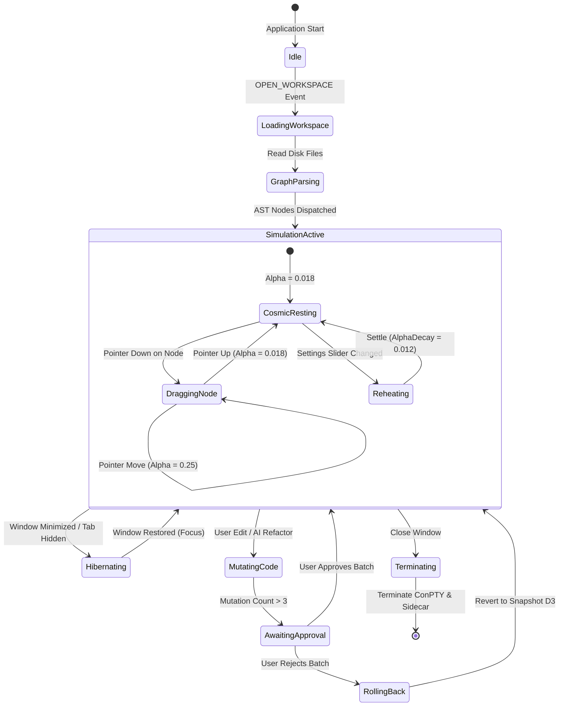

# IEEE 829 Test Design Specification (TDS)
**Project Title:** Neuron: The Spatial Code Intelligence IDE  
**Document Identifier:** `TDS-NEURON-2.4.0`  
**Standard Compliance:** IEEE Std 829-2008 Standard for Software and System Test Documentation  
**Document Type:** Formal Software Engineering Test Design  
**Status:** Approved  

---

## 1. Test Design Specification Identifier
`TDS-NEURON-2.4.0`

---

## 2. Features to be Tested

This design specification refines the testing approach defined in [`IEEE_829_TEST_PLAN.md`](file:///c:/Users/unity/OneDrive/Desktop/sem%205/Neuron/docs/software_engineering/IEEE_829_TEST_PLAN.md) and translates functional requirements into structured, mathematically validated test designs across the following features:
1. **Abstract Syntax Tree (AST) Parsing & Cyclic Dependency Resolution**
2. **Lossless Code Mutation & Refactoring Engine**
3. **Full-Duplex WebSocket Synchronization Hub**
4. **Atomic File Storage & Path Traversal Guard**
5. **Interactive ConPTY Terminal Multiplexer**
6. **Autonomous AI Blast Protection Guardrails**
7. **WebGPU Celestial Canvas & Level-of-Detail (LOD) Rendering**
8. **24-Parameter D3 Force Simulation Physics Engine**
9. **Multi-Key AI Provider Discovery & Fallback Router**
10. **Modular Workspace Tab Retention Engine**

---

## 3. Black-Box Test Design Techniques

### 3.1 Equivalence Partitioning (EP)

Input domains are partitioned into Valid Equivalence Classes (VEC) and Invalid Equivalence Classes (IEC), ensuring that a single test case from each class is representative of all members of that class.

#### EP Table 1: Camera Zoom Level & Level-of-Detail (LOD)
The celestial camera zoom $Z$ controls LOD filtering thresholds:

| Input Variable | Class Identifier | Input Range / Condition | Expected System Behavior |
| :--- | :--- | :--- | :--- |
| **Camera Zoom ($Z$)** | `VEC-Z01` (LOD 1) | $0.35 \le Z < \infty$ | Micro-view: Full AST symbols, functions, methods, code signatures visible. |
| | `VEC-Z02` (LOD 2) | $0.07 \le Z < 0.35$ | Meso-view: Class and file planet boundaries rendered; functions aggregated. |
| | `VEC-Z03` (LOD 3) | $0.03 \le Z < 0.07$ | Macro-view: Directory and package module suns active; files grouped into nebulae. |
| | `VEC-Z04` (LOD 4) | $0.001 \le Z < 0.03$ | Cosmic-view: Super-clusters rendered; individual AST nodes culled from GPU pipeline. |
| | `IEC-Z01` | $Z < 0.001$ | Clamped to minimum zoom floor $Z_{min} = 0.001$; rendering does not divide by zero. |
| | `IEC-Z02` | $Z > 10.0$ | Clamped to maximum zoom ceiling $Z_{max} = 10.0$; canvas does not invert or clip. |
| | `IEC-Z03` | $Z = \text{NaN}$ or $\pm\infty$ | Coordinate sanitization replaces invalid zoom with default fallback $Z = 1.0$. |

#### EP Table 2: AI Blast Protection Mutation Count ($M$)
The mutation file counter $M$ enforces safety thresholds on agent code writes:

| Input Variable | Class Identifier | Input Range / Condition | Expected System Behavior |
| :--- | :--- | :--- | :--- |
| **Mutated File Count ($M$)** | `VEC-M01` | $1 \le M \le 3$ (Blast Protection ON) | Automatic execution allowed; atomic pre-mutation snapshots saved. |
| | `VEC-M02` | $M > 3$ (Blast Protection ON) | Mutation blocked; interactive approval modal displayed; developer confirmation required. |
| | `VEC-M03` | $M \ge 1$ (Blast Protection OFF) | Direct write permitted without approval modal; pre-mutation snapshots retained. |
| | `IEC-M01` | $M = 0$ | No-op; mutation batch rejected with error code `EMPTY_BATCH`. |
| | `IEC-M02` | $M < 0$ or Non-integer | Validation schema throws `ValidationError`; transaction rejected immediately. |

#### EP Table 3: Physics Repulsion Strength ($R_{folder}$)
The folder repulsion force parameter $R_{folder}$ controls directory push forces:

| Input Variable | Class Identifier | Input Range / Condition | Expected System Behavior |
| :--- | :--- | :--- | :--- |
| **Folder Repulsion ($R_{folder}$)** | `VEC-R01` | $-8000 \le R \le -100$ | Valid force coefficient applied to Many-Body D3 simulation. |
| | `IEC-R01` | $R > -100$ (Positive / Weak) | Clamped to maximum allowed limit $-100$ to prevent cluster collapse. |
| | `IEC-R02` | $R < -8000$ (Excessive) | Clamped to minimum allowed limit $-8000$ to prevent celestial explosion. |
| | `IEC-R03` | $R = \text{NaN}$ | Safe fallback to default $-1800$. |

---

### 3.2 Boundary Value Analysis (BVA)

Boundary Value Analysis tests extremities around class partitions ($\text{min}-1$, $\text{min}$, $\text{nominal}$, $\text{max}$, $\text{max}+1$).

#### BVA Table 1: Level-of-Detail Transition Boundaries
| Boundary Variable | Test Value | Classification | Expected Output / Behavior |
| :--- | :--- | :--- | :--- |
| **LOD 4 Minimum** | $0.0009$ | Out-of-bounds (Low) | Clamped to $0.001$; GPU frustum culling active. |
| | $0.0010$ | Boundary Exact (Min) | LOD 4 cosmic clusters rendered; function text labels hidden. |
| | $0.0011$ | In-bounds (Nominal) | Smooth LOD 4 interpolation. |
| **LOD 3 Transition** | $0.0299$ | Below Transition | Evaluates as LOD 4. |
| | $0.0300$ | Boundary Exact | Transition point: Directory sun boundaries initiate fade-in. |
| | $0.0301$ | Above Transition | Evaluates as LOD 3. |
| **LOD 2 Transition** | $0.0699$ | Below Transition | Evaluates as LOD 3. |
| | $0.0700$ | Boundary Exact | Transition point: File planet nodes become interactive. |
| | $0.0701$ | Above Transition | Evaluates as LOD 2. |
| **LOD 1 Transition** | $0.3499$ | Below Transition | Evaluates as LOD 2. |
| | $0.3500$ | Boundary Exact | Transition point: Function moon nodes and signatures visible. |
| | $0.3501$ | Above Transition | Full micro-view active. |

#### BVA Table 2: AI Blast Shield Mutation Threshold ($Threshold = 3$)
| Test Point | Value ($M$) | Boundary Position | Expected Output |
| :--- | :--- | :--- | :--- |
| $M_1$ | 0 files | Below Minimum | Rejection: Empty mutation payload (`400 Bad Request`). |
| $M_2$ | 1 file | Valid Minimum | Autonomous write permitted; snapshot captured. |
| $M_3$ | 2 files | In-bounds (Nominal) | Autonomous write permitted; snapshot captured. |
| $M_4$ | 3 files | Boundary Upper Bound | Autonomous write permitted; snapshot captured. |
| $M_5$ | 4 files | Above Threshold ($3+1$) | Autonomous write blocked; `ApprovalModal` triggered; user prompt required. |

---

### 3.3 Decision Table Testing

Decision table modeling captures complex logical combinations of environmental rules and user permissions.

#### Decision Table 1: File Write & Mutation Engine Safety Logic
| Condition / Rule | Rule 1 | Rule 2 | Rule 3 | Rule 4 | Rule 5 | Rule 6 |
| :--- | :---: | :---: | :---: | :---: | :---: | :---: |
| **File Exists in Workspace?** | Yes | Yes | Yes | Yes | No | Yes |
| **Blast Protection Active?** | Yes | Yes | No | Yes | Any | Any |
| **Mutation Count > 3?** | No | Yes | Yes | Yes | Any | Any |
| **User Explicit Approval Given?** | N/A | Yes | N/A | No | Any | Any |
| **Valid File Extension?** | Yes | Yes | Yes | Yes | Yes | No |
| **Action: Execute Atomic Write** | **X** | **X** | **X** | | | |
| **Action: Capture Pre-Edit Snapshot**| **X** | **X** | **X** | | | |
| **Action: Display Approval Modal** | | | | **X** | | |
| **Action: Reject Write with Error** | | | | **X** | **X** | **X** |
| **Action: Log Security Incident** | | | | | **X** | **X** |

---

### 3.4 State Transition Testing

The core state transitions of the Neuron runtime are evaluated using a Finite State Machine (FSM) model.



---

## 4. White-Box Test Design Techniques

### 4.1 Control Flow & Basis Path Testing
For critical algorithmic units—such as the AST Graph Cycle Detector in [`backend/core/graph_builder.py`](file:///c:/Users/unity/OneDrive/Desktop/sem%205/Neuron/backend/core/graph_builder.py)—white-box basis path testing is performed.

#### Algorithmic Logic: Depth-First Search (DFS) Cycle Detection
```text
1:  def detect_cycles(graph):
2:      visited = set()
3:      rec_stack = set()
4:      cycles = []
5:      for node in graph.nodes:
6:          if node not in visited:
7:              if dfs(node, visited, rec_stack, cycles):
8:                  log_cycle_detected(node)
9:      return cycles
```

#### Cyclomatic Complexity Formulation
For a Control Flow Graph $G$ with $E$ flow edges, $N$ operational nodes, and $P$ connected components:
$$V(G) = E - N + 2P$$

With $E = 14$, $N = 10$, $P = 1$:
$$V(G) = 14 - 10 + 2(1) = 6$$

Alternative formulation based on predicate decision nodes $P$:
$$V(G) = P + 1 = 5 + 1 = 6$$

#### Independent Basis Paths
- **Path 1 (Empty Graph):** `1 -> 2 -> 3 -> 4 -> 5 (Exit False) -> 9`
- **Path 2 (All Visited):** `1 -> 2 -> 3 -> 4 -> 5 -> 6 (Node in visited) -> 5 -> 9`
- **Path 3 (Acyclic Traversal):** `1 -> 2 -> 3 -> 4 -> 5 -> 6 -> 7 (dfs returns False) -> 5 -> 9`
- **Path 4 (Direct Self-Loop Cycle):** `1 -> 2 -> 3 -> 4 -> 5 -> 6 -> 7 -> 8 -> 5 -> 9`
- **Path 5 (Multi-Node Indirect Cycle):** `1 -> 2 -> 3 -> 4 -> 5 -> 6 -> 7 (dfs recurse -> cycle found) -> 8 -> 9`
- **Path 6 (Disjoint Graph with Cycle in 2nd Subgraph):** `1 -> 2 -> 3 -> 4 -> 5 -> 7 (Acyclic) -> 5 (Next Root) -> 7 (Cycle found) -> 8 -> 9`

By implementing test cases targeting each of these six paths, **100% Branch and Statement Coverage** is guaranteed.

---

## 5. Test Suite Traceability Summary

The test techniques specified in this document directly inform the test cases defined in [`TEST_CASE_SPECIFICATION.md`](file:///c:/Users/unity/OneDrive/Desktop/sem%205/Neuron/docs/software_engineering/TEST_CASE_SPECIFICATION.md):
- **Equivalence Partitioning:** Applied across `TC-CAN-001..03`, `TC-PHY-001..04`, `TC-BLS-001..02`.
- **Boundary Value Analysis:** Applied across `TC-CAN-002`, `TC-BLS-001`, `TC-PHY-002`.
- **Decision Table Testing:** Applied across `TC-BLS-002..04`, `TC-FIL-001..03`.
- **State Transition Testing:** Applied across `TC-WSS-001..04`, `TC-MOD-001..04`.
- **Basis Path Testing:** Applied across `TC-AST-004..05`, `TC-MUT-003..04`.
